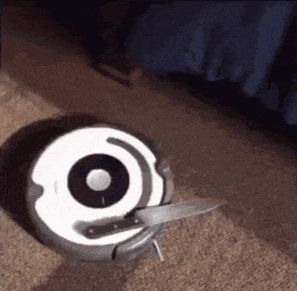
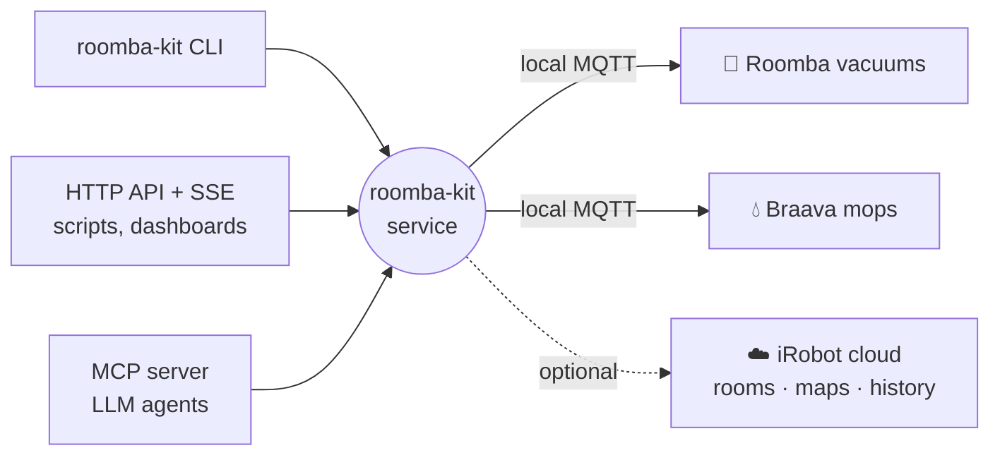

<div align="center">



# Roomba Kit

**Run your Roomba from the terminal, a script or an AI agent. No iRobot app required.**

[](https://github.com/Hfish21/roomba-kit/actions/workflows/ci.yml)

[](LICENSE)

<sub>Go get 'em, buddy. (Please don't actually do this.)</sub>

</div>

Roomba Kit is an unofficial, local-first control kit for iRobot's Wi-Fi robots: the Roomba
vacuums and Braava mops that speak iRobot's **local MQTT protocol**. One small service talks to
your robots over your own network and gives you a CLI, an HTTP API and an MCP server, all with
the same commands.

```console
$ roomba-kit clean Vacuum
robot_id   00000000000000000000000000000001
command    clean
outcome    confirmed
state      {"activity":"cleaning","mission":{…}}
waited_ms  2140
```

`confirmed` means the kit **saw the robot start cleaning**. It isn't just reporting that the
command was sent.

## Why

The robots are great hardware. The app has a few problems: schedules quietly stop firing, the
connection drops, and everything goes through a cloud that can change hands. iRobot did change
hands, in 2025. Robots this good deserve dependable software that you own.

Roomba Kit talks to the robots **locally**, so it keeps working with the internet down. The
iRobot cloud is an optional extra for room names, maps and history, and nothing local depends
on it.

## How it works



Each robot accepts exactly **one** local connection, so a single long-running service owns them
and everything else is its client. The CLI, HTTP routes and MCP tools are all generated from one
operation registry, so the three can't drift apart.

What a robot can do comes from its **model profile**: a small Python module that maps the
model's protocol quirks and declares its capabilities. Supporting a new model means adding a
profile, never touching the service or the surfaces.

## Features

- 🧹 **Control:** clean the whole house, clean specific rooms in order, pause, resume, stop,
  dock, find, empty the bin, reboot. Every command is confirmed against the robot's real state.
- 📡 **Live state and events:** battery, activity, bin, pad and tank, streamed over SSE (or
  `roomba-kit events watch`), with replay by sequence number.
- 📜 **Mission history** recorded locally with outcomes, plus an alert when a robot can't find
  its dock.
- ⚙️ **Settings** with read-back: passes, edge clean, child lock, pad wetness, and more.
- 📍 **Live position** on robots that report it.
- 🤖 **MCP tools** for LLM agents ("mop the kitchen, then vacuum the hallway").
- ☁️ **Optional cloud extras:** room import, floor plans, cloud history, coverage maps, a live
  room-level timeline.

## Supported robots

Roomba Kit is built for any Roomba or Braava that iRobot's local MQTT protocol can control.
Each model needs a profile, and these ship today:

| Robot | Profile | Status |
|---|---|---|
| Roomba i5 / i5+ | `roomba_i5` | ✅ Verified on hardware |
| Braava jet m6 | `braava_m6` | ✅ Verified on hardware |

Every capability is marked as verified on a real robot or not, in the
[support matrix](docs/reference/support-matrix.md). **Your model isn't listed?** The kit will
find it and say so, rather than guess at commands. A profile is mostly data, and
[Adding a model](docs/guides/adding-a-model.md) walks through writing one. New profiles are the
most welcome PR this repo can get.

## Quick start

Docker is the easiest way to run Roomba Kit, on any OS. **Close the iRobot app first:** each
robot only talks to one client at a time.

```bash
git clone https://github.com/Hfish21/roomba-kit.git && cd roomba-kit
docker compose -f deploy/compose.yaml up -d                                     # start the service
docker compose -f deploy/compose.yaml exec roomba-kit roomba-kit setup         # find and pair robots
docker compose -f deploy/compose.yaml exec roomba-kit roomba-kit clean Vacuum   # 🧹
```

`setup` looks for robots on your network and walks you through pairing: you hold the robot's
HOME button until it chimes, and the robot hands over its local password. Optionally, it then
logs in to the iRobot cloud.

> [!NOTE]
> On Docker Desktop (macOS, Windows), the container can't see your LAN's broadcasts, so
> discovery comes up empty. Give `setup` the robot's IP when it asks. To reach the API from the
> host itself, turn on host networking in Docker Desktop's network settings.

To save typing, alias it:

```bash
alias roomba-kit='docker compose -f /path/to/roomba-kit/deploy/compose.yaml exec roomba-kit roomba-kit'
```

The service restarts on its own, and its config and history live in Docker volumes. Run it on
something that stays on, because a sleeping host takes your robots' connections with it.

### Without Docker

You need Python 3.13+ and [uv](https://docs.astral.sh/uv/):

```bash
uv sync
uv run roomba-kit setup              # also starts the service
uv run roomba-kit service install    # optional: start at boot (systemd) or login (launchd)
```

[Getting started](docs/getting-started.md) is the full walk-through, and
[Deployment](docs/deployment.md) covers tokens, exposing the API on your LAN, and backups.

## Three ways in

**CLI**: for you and your shell scripts.

```bash
roomba-kit clean Vacuum --room Kitchen --room Hallway   # in that order
roomba-kit missions wait Vacuum                         # block until it's done
roomba-kit dock Mop
```

**HTTP API**: for scripts, dashboards and other services. Bearer-token auth, with OpenAPI docs
at `/v1/docs`.

```bash
roomba-kit token create my-script               # prints the token once
curl -X POST -H "Authorization: Bearer $TOKEN" \
  http://localhost:8765/v1/robots/Vacuum/commands/clean
```

**MCP**: for LLM agents. Point a client at `http://localhost:8765/mcp` (streamable HTTP, same
bearer token), or at the stdio command `roomba-kit mcp`. The tools are named after the
operations: `list_robots`, `clean`, `clean_rooms`, `dock`, and so on.

The [operations reference](docs/reference/operations.md) covers all three surfaces at once.

## FAQ

**Does this need the iRobot cloud?** No. Local control works with the internet unplugged. Add
cloud credentials only if you want room names, maps and history.

**Can I run it alongside the iRobot app?** Not at the same time. Each robot accepts one local
connection, and whoever connects first wins.

**Will a firmware update break it?** It could. iRobot doesn't document the local interface, so an
update could change it. To be safe, block the robots' internet access on your router; local
control doesn't need it.

**Is this custom firmware?** No. Roomba Kit talks to the stock firmware over its local
interface, and nothing is flashed.

**Why does `train` say unverified?** A mapping run can re-create the map and renumber your rooms,
so nobody has pressed that button for science yet.

## Docs

[Getting started](docs/getting-started.md) ·
[Setup](docs/setup.md) ·
[Deployment](docs/deployment.md) ·
[Troubleshooting](docs/troubleshooting.md) ·
[CLI](docs/reference/cli.md) ·
[Operations](docs/reference/operations.md) ·
[Events](docs/reference/events.md) ·
[Errors](docs/reference/errors.md) ·
[Protocol notes](docs/research/protocol-notes.md)

Or browse it all as a site: `uv run mkdocs serve`.

## Contributing

PRs are welcome, especially new model profiles. The test suite runs entirely against a fake robot
built from real captures, so you don't need hardware to contribute. Start with
[CONTRIBUTING.md](CONTRIBUTING.md).

## Credits

Built on [roombapy](https://github.com/pschmitt/roombapy) for the local protocol and
[roombapy-prime](https://pypi.org/project/roombapy-prime/) for the cloud, standing on the
shoulders of [dorita980](https://github.com/koalazak/dorita980), which first worked out how these
robots talk.

## License and disclaimer

[MIT](LICENSE). iRobot, Roomba and Braava are trademarks of iRobot Corporation. This project is
not affiliated with, endorsed by or supported by iRobot. It uses undocumented interfaces that
may change at any time. Use it at your own risk, and leave the knives in the drawer.
