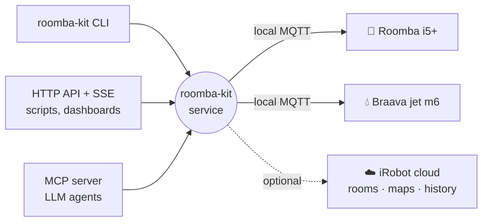

# Roomba Kit

**Run your Roomba from the terminal, a script or an AI agent. No iRobot app required.**

[](https://github.com/Hfish21/roomba-kit/actions/workflows/ci.yml)

[](LICENSE)

Roomba Kit is an unofficial, local-first control kit for the iRobot **Roomba i5/i5+** and
**Braava jet m6**. One small service talks to your robots over your own Wi-Fi and gives you a
CLI, an HTTP API and an MCP server, all with the same commands.

```console
$ roomba-kit clean Vacuum
robot_id   00000000000000000000000000000001
command    clean
outcome    confirmed
state      {"activity":"cleaning","mission":{…}}
waited_ms  2140
```

`confirmed` means the kit **saw the robot start cleaning**. It isn't just reporting that the
command was sent.

## Why

The robots are great hardware. The app has a few problems: schedules quietly stop firing, the
connection drops, and everything goes through a cloud that can change hands. iRobot did change
hands, in 2025. Robots this good deserve dependable software that you own.

Roomba Kit uses the robots' **local** MQTT interface, so it keeps working with the internet
down. The iRobot cloud is an optional extra for room names, maps and history, and nothing local
depends on it.

## How it works



Each robot accepts exactly **one** local connection, so a single long-running service owns them
and everything else is its client. The CLI, HTTP routes and MCP tools are all generated from one
operation registry, so the three can't drift apart.

## Features

- 🧹 **Control:** clean the whole house, clean specific rooms in order, pause, resume, stop,
  dock, find, empty the bin, reboot. Every command is confirmed against the robot's real state.
- 📡 **Live state and events:** battery, activity, bin, pad and tank, streamed over SSE (or
  `roomba-kit events watch`), with replay by sequence number.
- 📜 **Mission history** recorded locally with outcomes, plus an alert when a robot can't find
  its dock.
- ⚙️ **Settings** with read-back: passes, edge clean, child lock, pad wetness, and more.
- 📍 **Live position** on the Braava jet m6.
- 🤖 **MCP tools** for LLM agents ("mop the kitchen, then vacuum the hallway").
- ☁️ **Optional cloud extras:** room import, floor plans, cloud history, coverage maps, a live
  room-level timeline.
- 🏠 **Runs on whatever's always on:** systemd, launchd or Docker Compose.

## Supported robots

| Robot | Profile | Status |
|---|---|---|
| Roomba i5 / i5+ (`i5G5020`) | `roomba_i5` | ✅ Verified on hardware |
| Braava jet m6 (`m611020`) | `braava_m6` | ✅ Verified on hardware |

Every capability is marked as verified on a real robot or not, in the
[support matrix](docs/reference/support-matrix.md), with the test runs in
[`docs/verification/`](docs/verification/). Other models that speak the same local protocol
probably work with a new profile; see [Adding a model](docs/guides/adding-a-model.md).

## Quick start

You need Python 3.13+, [uv](https://docs.astral.sh/uv/), and a machine on the same network as
the robot. **Close the iRobot app first:** the robot only talks to one client at a time.

```bash
git clone https://github.com/Hfish21/roomba-kit.git && cd roomba-kit
uv sync
uv run roomba-kit setup          # finds robots, walks you through pairing, optional cloud login
uv run roomba-kit robots list    # wait for "connected"
uv run roomba-kit clean Vacuum   # 🧹
```

For pairing, setup asks you to hold the robot's HOME button until it chimes. That's how the
robot hands over its local password. The full walk-through is in
[Getting started](docs/getting-started.md).

## Three ways in

**CLI**: for you and your shell scripts.

```bash
roomba-kit clean Vacuum --room Kitchen --room Hallway   # in that order
roomba-kit missions wait Vacuum                         # block until it's done
roomba-kit dock Mop
```

**HTTP API**: for scripts, dashboards and other services. Bearer-token auth, with OpenAPI docs
at `/v1/docs`.

```bash
roomba-kit token create my-script               # prints the token once
curl -X POST -H "Authorization: Bearer $TOKEN" \
  http://127.0.0.1:8765/v1/robots/Vacuum/commands/clean
```

**MCP**: for LLM agents. Point a client at `http://127.0.0.1:8765/mcp` (streamable HTTP, same
bearer token), or at the stdio command `roomba-kit mcp`. The tools are named after the
operations: `list_robots`, `clean`, `clean_rooms`, `dock`, and so on.

The [operations reference](docs/reference/operations.md) covers all three surfaces at once.

## Running it for real

Put the service on something that doesn't sleep. A laptop that closes its lid takes your robots'
connection with it.

| Host | How |
|---|---|
| Linux box (Pi, NUC, home server) | `roomba-kit service install`, a systemd user unit |
| Linux with Docker | `docker compose -f deploy/compose.yaml up -d` (host networking, for discovery) |
| Always-on Mac | `roomba-kit service install`, a launchd agent |

See [Deployment](docs/deployment.md) for tokens, exposing the API on your LAN, and backups.

## FAQ

**Does this need the iRobot cloud?** No. Local control works with the internet unplugged. Add
cloud credentials only if you want room names, maps and history.

**Can I run it alongside the iRobot app?** Not at the same time. Each robot accepts one local
connection, and whoever connects first wins.

**Will a firmware update break it?** It could. Both supported robots run firmware from 2022 or
earlier (the i5's is its final release), but an update could change the local interface. To be
safe, block the robots' internet access on your router; local control doesn't need it.

**Is this custom firmware?** No. The robots enforce secure boot. Roomba Kit talks to the stock
firmware over its local interface.

**Why does `train` say unverified?** A mapping run can re-create the map and renumber your rooms,
so nobody has pressed that button for science yet.

## Docs

[Getting started](docs/getting-started.md) ·
[Setup](docs/setup.md) ·
[Deployment](docs/deployment.md) ·
[Troubleshooting](docs/troubleshooting.md) ·
[CLI](docs/reference/cli.md) ·
[Operations](docs/reference/operations.md) ·
[Events](docs/reference/events.md) ·
[Errors](docs/reference/errors.md) ·
[Protocol notes](docs/research/protocol-notes.md)

Or browse it all as a site: `uv run mkdocs serve`.

## Contributing

PRs are welcome, especially new model profiles. The test suite runs entirely against a fake robot
built from real captures, so you don't need hardware to contribute. Start with
[CONTRIBUTING.md](CONTRIBUTING.md).

## Credits

Built on [roombapy](https://github.com/pschmitt/roombapy) for the local protocol and
[roombapy-prime](https://pypi.org/project/roombapy-prime/) for the cloud, standing on the
shoulders of [dorita980](https://github.com/koalazak/dorita980), which first worked out how these
robots talk.

## License and disclaimer

[MIT](LICENSE). iRobot, Roomba and Braava are trademarks of iRobot Corporation. This project is
not affiliated with, endorsed by or supported by iRobot. It uses undocumented interfaces that
may change at any time. Use it at your own risk, and maybe pick up the Lego first.
